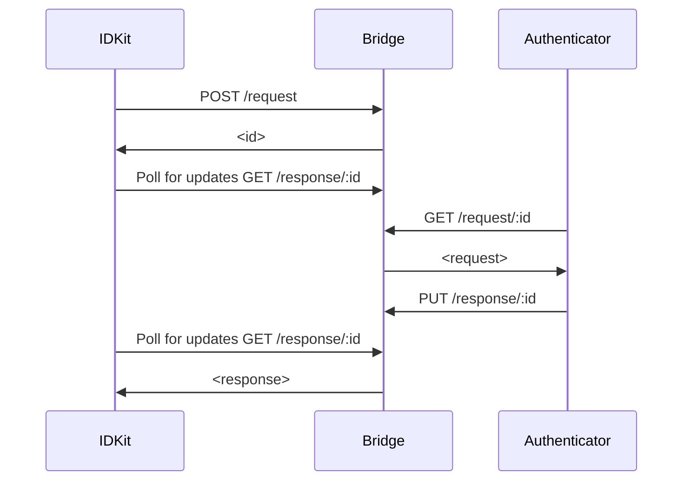
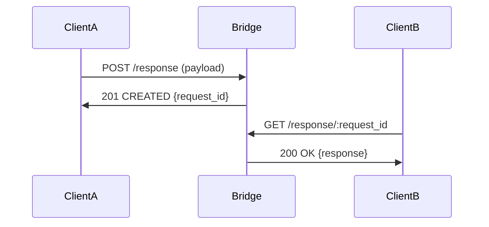

# Message Bridge (previously Wallet Bridge)

The message bridge is a **dumb**, environment and client agnostic relay of arbitrary messages. It lets two parties share an arbitrary message where parties can gossip a 
symmetric key off-band.

The bridge is made so that it cannot eavesdrop on any messages. The bridge expects only ciphertext. **All clients MUST encrypt all payloads before submitting to the bridge.**.

- **Importantly** this bridge is completely agnostic to any client or environment, it simply relays messages, hence it implements no logic or opinions related to client handling.
- All messages received by this bridge are temporarily held for delivery, but are automatically purged after a period of time. This service has and SHOULD NOT have _persisting_ storage.

## Use Case: World ID Protocol

The bridge is currently used in the [World ID Protocol](https://github.com/worldcoin/world-id-protocol). The most used path is for RPs to request proofs from users (to their Authenticators) and for Authenticators to send back proofs.

### Example Flow



### Endpoints

- `POST /request`: Called by IDKit. Initializes a proof verification request.
- `GET /request/:id`: Called by Authenticator. Used to fetch the proof verification request. One time use.
- `HEAD /request/:id`: Existence check for a request. `200` if present, `404` otherwise.
- `PUT /response/:id`: Called by Authenticator. Used to send the proof back to the application.
- `GET /response/:id`: Called by IDKit. Continuous pulling to fetch the status of the request and the response if available. Response can only be retrieved once.
- `HEAD /response/:id`: Existence check for a request's status. `200` if present, `404` otherwise.
- `POST /response`: Called by a client to create a standalone response without a prior request (see [Standalone Response Flow](#standalone-response-flow)).
- `PUT /request/:id`: Staging only (`ENVIRONMENT == "staging"`). Idempotent request upsert.

Response uploads may include an optional `tracking_receipt` alongside `iv` and
`payload`. The receipt remains opaque, expires with the response, and is never
returned to the response consumer. When `ANALYTICS_CALLBACK_URL` is set, the bridge
sends the receipt to that URL after the response is dequeued and decoded. Leave the variable unset to disable
callbacks; a configured URL must be valid (an empty value is invalid). Analytics
delivery is best-effort and never blocks response delivery. Operational metrics
and tracing remain enabled independently of callbacks.

### Standalone Response Flow

This flow allows a client to send a `/response` without first generating a `/request` first.



## Local Development

An easy way to run is using a Dockerized Redis:

```
docker run -d -p 6379:6379 redis
```

When building the Dockerfile locally remember to specify the `--platform=linux/amd64` flag.

## Testing

Integration tests build the bridge in-process and drive it directly, so the only external dependency is Redis (override its location with `REDIS_URL`):

```bash
docker-compose -f docker-compose.test.yml up -d
cargo test
```

## Rust client and test server

`crates/client` contains `message-bridge-client`, a standalone HTTP client with no
server, Redis, or application-protocol dependencies. It supports publishing and taking
requests, polling response state, and submitting responses. Callers supply unique,
high-entropy request ids and already encrypted `iv` / `payload` strings. It does not
perform encryption. Native TLS trusts bundled Mozilla roots; WASM uses browser TLS.

The server library exports `app(...)` for embedding and `server::start(...)` for the
executable. Enable `test-util` to use `test_util::TestServer` in downstream integration
tests. It binds an ephemeral loopback port and runs the production router, with no app
overrides or analytics callbacks:

```rust,no_run
use world_id_bridge::test_util::TestServer;
use message_bridge_client::BridgeClient;

# async fn example() -> Result<(), Box<dyn std::error::Error + Send + Sync>> {
let server = TestServer::start("redis://127.0.0.1:6379").await?;
let client = BridgeClient::new(server.base_url().parse()?)?;
// Exercise the application with `client`.
server.shutdown().await?;
# Ok(())
# }
```

Redis must already be running (the test helper does not start infrastructure or flush
data). Use unique ids or a dedicated instance; messages retain the production TTL.
Dropping the handle aborts the server, while `shutdown()` waits for it and reports
failures. Run the full suite, including the client against the real server, with:

```bash
REDIS_URL=redis://127.0.0.1:6379 cargo test --workspace --all-features
```
